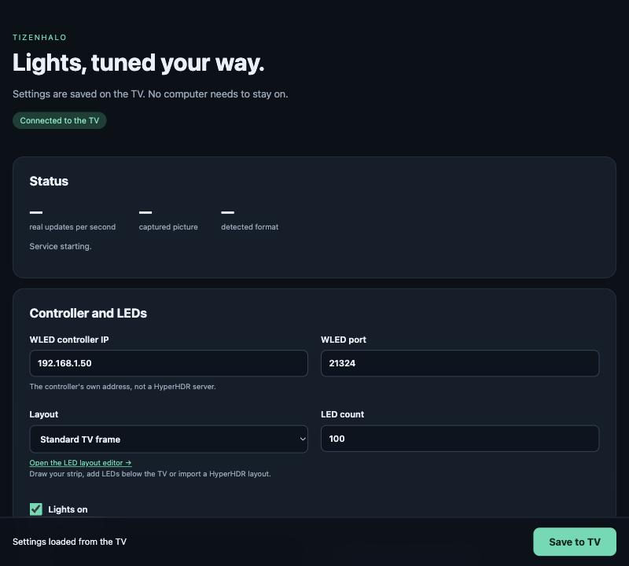
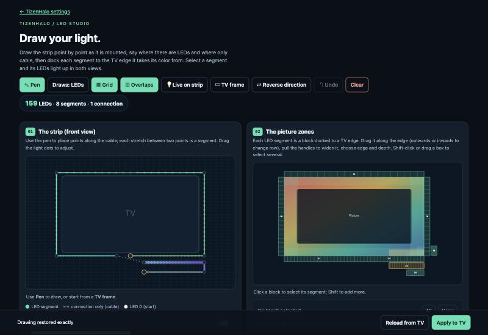
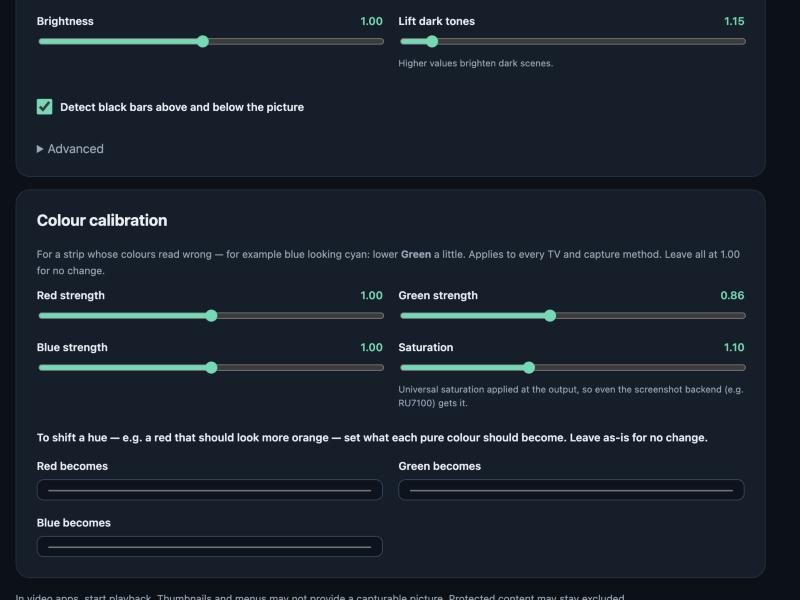

# TizenHalo

**Bias lighting for Samsung Tizen TVs.** A small app runs on the TV itself, reads the on-screen picture
and drives a [WLED](https://kno.wled.ge/) LED strip over your network. No capture card, no HDMI
splitter, no computer or Raspberry Pi.

TizenHalo is a fork of [TizenAmbilight](https://github.com/RitwickVerma/TizenAmbilight) by Ritwick Verma.

You set it up entirely from your phone — a web page served by the TV:

| Settings | LED Studio layout editor |
|---|---|
|  |  |

## What it does

- Runs entirely on the TV, as a background service. You adjust it from your phone: the app menu shows a
  QR code to the settings page.
- Captures the picture and averages the edges into LED zones, then smooths the LED output (interpolation
  to 30 or 60 Hz) so the light stays fluid even when captures are only a few per second.
- Uses a standard frame around the screen, or a layout you draw in **LED Studio**, the built-in editor:
  draw the strip segment by segment as it is mounted (LEDs under a stand, cable-only jumps, odd shapes),
  watch it live on the real strip while you edit, and dock each segment to the TV edge it takes its color
  from. HyperHDR layouts can be imported.
- Detects black bars, handles HDR10 and HLG where available, and adapts its smoothing to the scene.
- **Colour calibration** (see below) to match the strip's colours to what you want.

## Supported TVs

The capture interface is private to each firmware family, so support is per-model. Install **one**
package, matched to the TV:

| Package | TV / runtime | Status |
|---|---|---|
| `…-q74t-55.tpk` | 2020 Q-series, Tizen 5.5 — tested on QE55Q74T | **Working** — the reference build |
| `…-ru7100-50.tpk` | RU7100, Tizen 5.0 | **Working, early** — captures and drives LEDs; capture rate is being optimised |
| `…-rgb-55.tpk` | RGB point sampler, Tizen 5.5+ | Experimental — not tested on any TV |
| `…-s84f-90.tpk` | S84F, Tizen 9 | Experimental — not tested on any TV |

> [!WARNING]
> TizenHalo uses undocumented Samsung system libraries that differ between models and firmware. A build
> is only as good as the TV it was tested on. If you try it on another TV, please open an issue and say
> what happened, whether it worked or not — a failure report is just as useful.

Get the packages from the [latest release](https://github.com/tenda96/TizenHalo/releases/latest).

## Requirements

- A supported Samsung TV (see the table above).
- A WLED controller with UDP realtime enabled (default port 21324), up to 490 LEDs.
- TV and controller on the same local network.

## Install

Samsung TVs only install packages signed for that specific TV. The `.tpk` from a release (or from
`./build.sh`) is signed with the Tizen SDK's default certificate, which a retail TV rejects, so it must
be re-signed for your TV first:

- **[Apps2Samsung](https://github.com/Apps2Samsung/Apps2Samsung)** re-signs a package for your TV and
  installs it, or
- **your own certificate:** create a Samsung certificate profile for your TV in Tizen Studio's
  Certificate Manager, re-sign the package with it and install it with the Tizen CLI.

To build the packages yourself, see [Build from source](docs/TECHNICAL.md#build-from-source) and
[build profiles](docs/BUILD-PROFILES.md).

## First setup

1. Open **TizenHalo** from the TV's apps. The menu shows a QR code and an address like
   `http://<tv-ip>:8793`.
2. Open it on your phone or computer. Enter the WLED controller's IP and the number of LEDs, then set
   where the first LED is and which way the strip runs. Save.
3. Play a video. The lights follow it; press Back on the remote to return to the video — the service
   keeps running.

For anything other than a plain frame (LEDs under a stand, gaps, odd shapes), open **LED Studio** from
the settings page. Turn on **Live on strip** to see on the real LEDs which ones each segment covers, then
**Apply to TV**. Every setting is described in [docs/CONFIGURATION.md](docs/CONFIGURATION.md).

## Colour calibration

If the strip's colours don't look right, the **Colour calibration** section fixes them, for every TV and
capture method:

- **Red / Green / Blue strength** and **Saturation** — trim how strong each channel and the overall
  colour are. Lower Green a little if blue reads as cyan.
- **Red / Green / Blue becomes** — set what a *pure* red, green or blue should become. This shifts a
  hue, which the strength sliders cannot: for example a red that should read a little more **orange**.

All controls default to no change.

## Limitations

- **Capture rate depends on the TV.** On the Q74T the firmware delivers about 15 fresh frames per second;
  the RU7100's screenshot path is slower for now. Interpolation keeps the LEDs smooth either way.
- **Protected content is not captured.** Many streaming apps withhold their picture; the lights go dark
  there, with no fallback on these firmwares.
- **The settings page has no password.** Anyone on your local network can change the settings; keep it
  off the public internet.

## Troubleshooting

| Symptom | Check |
|---|---|
| Lights never turn on | WLED IP and port on the settings page; UDP realtime enabled in WLED; a video is playing |
| Colours on the wrong side | "First LED position" and strip direction, or draw the layout in the editor |
| Colours look wrong | The **Colour calibration** section above |
| Lights stay dark in one app | The content is probably protected |

The status line on the settings page and `http://<tv-ip>:8793/api/status` show what the service is doing.

## Documentation

- [Configuration](docs/CONFIGURATION.md): settings, defaults, LED mapping, layout file format.
- [Technical notes](docs/TECHNICAL.md): architecture, capture methods and measurements, local API, building.
- [Build profiles](docs/BUILD-PROFILES.md): the per-TV packages and how they are built.
- [Compatibility research](docs/COMPATIBILITY.md) and the [device catalogue](docs/DEVICES.md).
- [Changelog](CHANGELOG.md)

## License and credits

MIT, see [LICENSE](LICENSE). Based on TizenAmbilight by Ritwick Verma (MIT). The QR code in the TV menu
uses [Net.Codecrete.QrCodeGenerator](https://github.com/manuelbl/QrCodeGenerator) (MIT).

TizenHalo is an independent project, not affiliated with or endorsed by Samsung, WLED or Philips.
Samsung, Tizen, WLED and Ambilight are trademarks of their respective owners. It does not bypass content
protection. Use it at your own risk; it relies on undocumented system interfaces that a firmware update
can change or remove.
